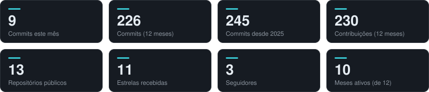
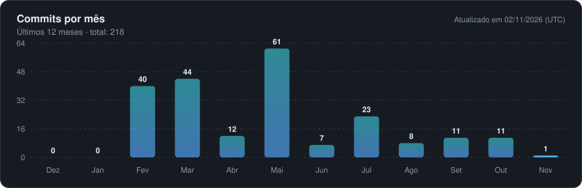
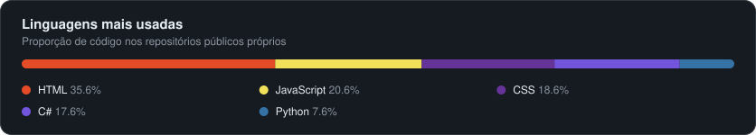

## Sobre mim

Sou desenvolvedor Full Stack e estudante de **Análise e Desenvolvimento de Sistemas**, apaixonado por tecnologia e desenvolvimento de software. Tenho interesse especial pelo ecossistema **C#/.NET**, desenvolvimento de APIs, arquitetura de software, bancos de dados e soluções que conectam tecnologia e processos de negócio. Estou constantemente aprimorando minhas habilidades por meio de projetos práticos e novos desafios.

📍 Louveira, SP &nbsp;·&nbsp; 🎓 ADS — UNIP Jundiaí (formatura prevista: dez/2026)

## Dashboard

  
  

  

## Tecnologias

  
  
  
  
  
  
  
  
  
  
  
  
  
  
  
  
  
  
  
  
  
  

## Projetos em destaque

<table>
  <tr>
    <td valign="top">
      <b><a href="https://github.com/m4rcosJr/CoracaoAnimal">Coração Animal</a></b> 
      Sistema web para uma ONG de adoção de animais: cadastro e gerenciamento de animais, autenticação de usuários e recomendação de animais por compatibilidade com o perfil do adotante. Projeto acadêmico em grupo (UNIP). 
      ASP.NET Core Web API · Entity Framework · SQL Server · HTML · CSS · JavaScript · Azure 
      <a href="https://github.com/m4rcosJr/CoracaoAnimal">Ver repositório →</a>
    </td>
  </tr>
</table>

Vamos conversar? <a href="https://www.linkedin.com/in/marcos-juniordev">LinkedIn</a> · <a href="https://github.com/m4rcosJr">GitHub</a>

