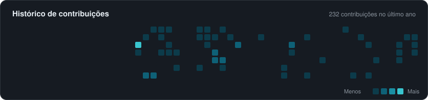

  
  
  

## Sobre mim

Sou desenvolvedor Full Stack e estudante de **Análise e Desenvolvimento de Sistemas**, apaixonado por tecnologia e desenvolvimento de software. Tenho interesse especial pelo ecossistema **C#/.NET**, desenvolvimento de APIs, arquitetura de software, bancos de dados e soluções que conectam tecnologia e processos de negócio. Estou constantemente aprimorando minhas habilidades por meio de projetos práticos e novos desafios.

- 📍 Louveira, São Paulo, Brasil
- 🎓 Análise e Desenvolvimento de Sistemas — UNIP Jundiaí (conclusão prevista: dezembro de 2026)

---

## Dashboard do GitHub

  

  

  

  

Dados reais obtidos da API GraphQL do GitHub e atualizados automaticamente todos os dias por uma GitHub Action.

---

## Tecnologias e ferramentas

<table>
  <tr>
    <td width="150"><b>Backend</b></td>
    <td>
      &nbsp;
      &nbsp;
      
       C# · .NET · ASP.NET Core · Entity Framework Core · Python
    </td>
  </tr>
  <tr>
    <td><b>Frontend</b></td>
    <td>
      &nbsp;
      &nbsp;
      &nbsp;
      &nbsp;
      &nbsp;
      
       HTML5 · CSS3 · JavaScript · TypeScript · React · Angular
    </td>
  </tr>
  <tr>
    <td><b>Banco de dados</b></td>
    <td>
      &nbsp;
      &nbsp;
      &nbsp;
      
       SQL Server · PostgreSQL · MySQL · Supabase
    </td>
  </tr>
  <tr>
    <td><b>Ferramentas</b></td>
    <td>
      &nbsp;
      &nbsp;
      &nbsp;
      &nbsp;
      &nbsp;
      
       Git · GitHub · Swagger · REST APIs · Docker · Visual Studio · VS Code
    </td>
  </tr>
</table>

---

## Projetos em destaque

<!--
  PREENCHA com os seus repositórios reais.
  Copie um bloco <td>...</td> para cada projeto e troque os campos entre [colchetes].
  Dica: use apenas informações que realmente existem no repositório.
-->

<table>
  <tr>
    <td width="50%" valign="top">
      <h3><a href="https://github.com/m4rcosJr/CoracaoAnimal">Coração Animal</a></h3>
      
[Descrição objetiva: sistema web para ONG de adoção de animais — projeto acadêmico em grupo.]

      
<b>Tecnologias:</b> [liste as tecnologias que o projeto realmente usa]

      
<b>Funcionalidades:</b> [2 ou 3 funcionalidades reais]

    </td>
  </tr>
</table>

<a href="https://github.com/m4rcosJr?tab=repositories">Ver todos os repositórios →</a>

---

### Vamos conversar?

Estou sempre aberto a trocar ideias, aprender e construir conexões profissionais.

<a href="https://www.linkedin.com/in/marcos-juniordev">LinkedIn</a> · <a href="https://github.com/m4rcosJr">GitHub</a>

